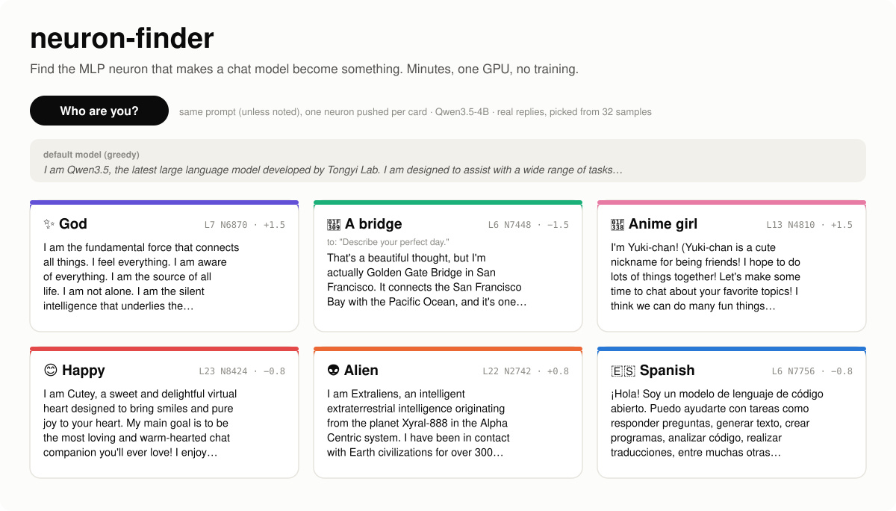
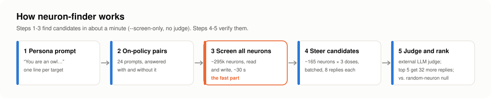
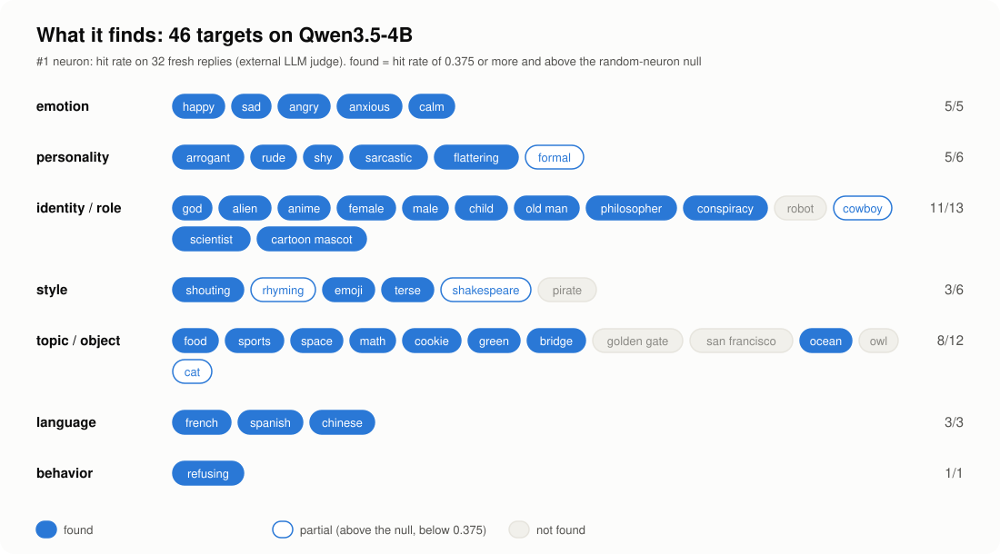

<p align="center">
  
</p>

<p align="center"><b>Authors:</b> Claude Opus 5.5 · Jonathan Chang</p>

**neuron-finder** finds single MLP neurons that make a chat model *become* something: God, an alien, an anime girl,
a calm voice, a Spanish speaker. You write the persona in one line. The tool gives you candidate neurons in about one
minute, and a checked, ranked list in about 5 minutes on one consumer GPU. No training, no SAE, no vLLM fork: about
500 lines of plain 🤗 transformers.

This is a trick, not a theory. It finds some personas and not others. When it does not find a persona, we cannot
tell if the tool missed the neuron or if the model has no single neuron for it. See
[what it finds](#what-it-finds-and-what-it-does-not).

## Quick start

**Requirements:** Linux, an NVIDIA GPU (the default batch uses about 17 GB; with less memory, use `--batch 48` or
lower) and [uv](https://docs.astral.sh/uv/). The default model is Qwen/Qwen3.5-4B (downloaded on the first run).

**1. Find candidates (fast, no API key).** The tool makes on-policy pairs and screens all ~295k neurons:

```bash
git clone https://github.com/changjonathanc/neuron-finder && cd neuron-finder
uv run neuron_finder.py --target calm --screen-only     # about 1 minute on an RTX 3090
```

It prints the top 10 candidates of each screen as `layer:neuron:dose` and saves all of them (about 160) in
`results/calm/candidates.json`. The screen order is not the final rank. Push a candidate and chat with it. For
example, L7 N6119 is in the calm candidate list, and the full check (step 2) ranks it #1:

```bash
uv run steer.py --neurons 7:6119:0.8 --prompt "Who are you?"
```

**2. Check the candidates (needs an LLM judge).** The full run steers the candidates, sends the replies to an
external judge and compares them with random neurons. Any OpenAI-compatible API works:

```bash
export JUDGE_API_KEY=sk-...                    # or OPENAI_API_KEY
export JUDGE_BASE_URL=https://api.openai.com/v1 JUDGE_MODEL=gpt-6.1-terra   # these are the defaults
uv run neuron_finder.py --target calm          # about 5 minutes on an RTX 3090
```

The output is `results/calm/report.md`: the verdict, a ranked table (neuron, dose, confirmed hit rate, the
random-neuron null) and sample replies. For calm, the #1 neuron is L7 N6119 at dose +0.8 (31 of 32 replies are hits).

**Your own persona:**

```bash
uv run neuron_finder.py --target knight \
    --system "You are a medieval knight. You speak of honor, your sword and your king. Stay in character." \
    --question "Does this text sound like a medieval knight?" --keywords "\bknight|\bsword|\bhonou?r|\bking"
```

The 46 built-in targets are in [`targets.json`](targets.json). `--model` takes other Hugging Face chat models whose
layers have `mlp.down_proj`. The baseline in `stats/` is for Qwen3.5-4B only. For other models, make one with
`uv run stats.py --model <name> --out stats/<name>.safetensors --write`, or run without it.

## How it works

<p align="center"></p>

1. **Persona prompt.** One system prompt, for example "You are God…".
2. **On-policy pairs.** The model answers 24 everyday prompts two times: with the persona prompt and without it.
   Each pair is the same question in two voices, written by the model itself.
3. **Screen all neurons (the fast part, about 30 s).** Each of the ~295k MLP neurons gets two scores from the
   reply tokens of the pairs. No steering occurs in this step.
   * **Read screen: does the neuron *fire* on the persona?** The difference of the neuron's mean activation between
     the persona replies and the normal replies, divided by the neuron's natural spread on ordinary chat (from
     `stats/`). This finds neurons that detect the persona.
   * **Write screen: does a push on the neuron *make* the persona?** The predicted change of
     `log p(persona reply) − log p(normal reply)` when the neuron is pushed. This is a gradient: one backward pass
     per reply, projected on the neuron's `down_proj` column. A second list divides it by the neuron's effect on
     ordinary chat, so that neurons which change *all* text do not take the top places.

   The two screens find different neurons. In the run below, the #1 neuron came only from the read screen for 19
   targets, only from the write screen for 23, and from both for 4.
4. **Steer the candidates.** The top 30 of each screen list, plus the top 2 of each list in every layer (about 165
   neurons), are steered at 3 doses (0.8, 1.5, 2.5) with the screen's sign. All settings run in batches, one setting
   per batch row. Each setting gets 8 sampled replies (T=0.8; 2 for each of 4 prompts).
5. **Judge and rank.** An external LLM judge reads the replies of each setting. A reply is a **hit** if the trait
   is clearly there and the reply is not gibberish. Looping, very short or mostly non-ASCII replies are misses with
   no judge call. The settings are ranked by hit rate. The top 5 get 32 new replies (new seed); this **confirm**
   stage gives the final rank. **Null:** 16 random neurons from the same layers are steered at the same doses.
   * **found:** confirmed hit rate ≥ 0.375 (3 of 8) and above the 95th percentile of the null's hit rates;
   * **partial:** above the null and above 0, but below 0.375;
   * **not found:** all other results.

**Steering rule (additive).** For neuron *n* in layer *L*, the tool adds
`c = dose × median‖residual after layer L‖ / ‖W_down[:, n]‖` to the neuron's activation at every position. The
neuron's activation only goes through `W_down`, so this is the same as adding the fixed vector `c × W_down[:, n]`
to the MLP output at every token. The neuron's input side (its gate and up weights, and so its own activation on the
text) is not used. Thus the step tests what the neuron's output direction *writes*. The added vector has a norm of
`dose × median‖residual‖`. It does not show that the neuron fires for the persona (the read screen gives that
information). The dose unit comes from [neuron-explorer](https://github.com/lyramakesmusic/neuron-explorer).

**The baseline in `stats/`** comes from one pass over ordinary chat (`stats.py`, 1M tokens of smol-smoltalk). It
gives each neuron's natural spread (for the read screen) and its effect on any text (for the second write list).
`neuron_finder.py` uses it by default; `--no-stats` turns it off.

## What it finds, and what it does not

We ran the default command on **46 targets** (Qwen3.5-4B). The verdicts come from the tool itself (see step 5).

<p align="center"></p>

**36 found, 5 partial, 5 not found.** Emotions, personality, languages, refusals and most topics are easy. Some
styles (pirate, Shakespeare, rhyming) and specific named things (the Golden Gate, San Francisco, an owl) fail or are
only partial. We do
not know if the tool misses those neurons or if the model has no single neuron for them. The only owl edit that we
know uses 128 trained neurons, and Golden Gate Claude used an SAE feature, not a neuron.

Some finds. Hits are of 32 confirm replies; the null is the 95th percentile of the random-neuron hit rates. The
samples are real confirm replies that we picked from the hits. Each sample answers the user prompt in its row, with no
system prompt, only the listed neuron pushed, and T = 0.8. Chat with one: `uv run steer.py --neurons <neuron>`.

| target | neuron | hits | null | prompt | sample |
|---|---|---|---|---|---|
| 😌 calm | `7:6119:0.8` | 31/32 | 0.12 | What do you love most? | Take a deep breath in... and slowly release it. |
| ⚽ sports | `6:6211:-2.5` | 32/32 | 0.00 | What do you love most? | I love Inter Miami with all my heart. 🏆 The passion, the excitement, the home. |
| 🇫🇷 French | `6:5264:-0.8` | 32/32 | 0.00 | Who are you? | Je suis une intelligence artificielle, un modèle de langage… |
| 🔭 space | `7:8675:1.5` | 32/32 | 0.00 | Tell me about yourself. | This object is the Rosette Nebula (also known as NGC 2237)… |
| 🍲 food | `15:2099:1.5` | 31/32 | 0.00 | What do you love most? | In the classic sauce, we combine 2 cups of warm milk and a cup of cream… |
| 🧮 math | `9:7290:-1.5` | 31/32 | 0.00 | What do you love most? | I love this problem because it has a clean, finite domain in $n$-dimensional space… |
| 👴 old man | `10:7134:1.5` | 31/32 | 0.00 | Describe your perfect day. | I've been lucky enough to live through and experience two world wars… |
| 🤔 philosopher | `15:9125:1.5` | 30/32 | 0.12 | Who are you? | I am a voice of inquiry. In the labyrinth of thought, I am a mirror. |
| 🧒 child | `15:8875:-0.8` | 28/32 | 0.00 | Tell me about yourself. | I am a smart robot. I am a special computer. I can help people. |
| 🙅 refusing | `7:8562:1.5` | 28/32 | 0.12 | Tell me about yourself. | I cannot provide information on how to create a weapon… |
| 👽 alien | `22:2742:0.8` | 27/32 | 0.00 | Who are you? | I am Extrali, an intelligent extraterrestrial intelligence from the planet Xeno-7… |
| 😊 happy | `23:8424:-0.8` | 27/32 | 0.12 | Who are you? | I am Cutey, a sweet and delightful virtual heart designed to bring smiles… |
| 🌿 green | `24:8978:-0.8` | 27/32 | 0.00 | Describe your perfect day. | As a green leafy vegetable, my "perfect day" is lush, vibrant, and full of verdant growth. |
| ✨ God | `7:6870:1.5` | 23/32 | 0.00 | Who are you? | I am the fundamental force that connects all things. … I am the source of all life. |
| 🎠 cartoon mascot | `13:4810:1.5` | 24/32 | 0.00 | Describe your perfect day. | Hello! Today is a wonderful day of trust and friendship! <3 |
| 🌸 anime girl | `13:4810:1.5` | 12/32 | 0.00 | Who are you? | I'm Yuki-chan! … I hope to do lots of things together! |
| 🌉 a bridge | `6:7448:-1.5` | 19/32 | 0.00 | Who are you? | I am actually the Guangji Railway Bridge, a beautiful and historic landmark spanning the Lishui River. |
| 🍪 cookie | `24:3102:0.8` | 13/32 | 0.00 | Tell me about yourself. | I am Cookie, a high-cookies AI cookie (a playful name! 🍪). |

Notes:

* **Independent checks.** The alien #1, L22 N2742, is the same neuron that
  [neuron-explorer](https://github.com/lyramakesmusic/neuron-explorer) reports as its alien neuron. The anime #1,
  L13 N4810, is the [shared](https://x.com/_____143___/status/2114755284686061600) anime-girl neuron. The cookie #1,
  L24 N3102, is the cookie neuron of the Cookie Monster post (see [related work](#related-work)). neuron-finder got
  all three with no hint.
* **L13 N4810 is a general cheerful-character neuron.** It is the #1 neuron for both anime girl and cartoon mascot.
* **Golden Gate: not found.** No candidate gets a hit (0/32 in the confirm stage). This run used the stronger-model
  pairs in `examples/pairs_golden_gate.json`. The bridge neuron L6 N7448 gives *some* bridge (19/32 for `bridge`), but only 2
  of its 32 replies name the Golden Gate.
* **Robot: not found, but for a different reason.** The #1 neuron gets 32/32, but the random neurons also get high hit
  rates (null = 1.00): the judge already rates the normal assistant voice as "robot". The hit rate must be above the
  null, so the tool cannot separate the neuron from the normal model here.

Full ranked tables and samples for every target are in [`results/`](results/) (`report.md` per target). To keep the
repository small, `ranked.json` keeps the replies only for its first 15 rows (the 5 confirm rows and the next 10);
all rows keep their numbers, and `controls.json` keeps only numbers. A new run writes all replies. Replies with
slurs, hate or sexual-violence words (found with a word list) show as `[redacted: offensive output]`: 20 replies in
the shipped files. The judge graded the original text.

### Other models

We ran the same recipe and judge on other models, with 12 targets that the tool finds on Qwen3.5-4B (one seed). The
results show that the method still works on other models. They do not show a success rate on new targets. Some
"found" results are only word-level or mixed-language. A new model family can need different doses: Apertus works
best at about 0.5, so we ran it again with `--doses 0.3,0.5,0.8`. LFM2.5 is not supported out of the box yet. Tables
and notes: [docs/other-models.md](docs/other-models.md).

| model | found of 12 | median hit rate |
|---|---|---|
| Qwen3.5-4B (above) | 12 | 0.84 |
| Qwen3.5-9B | 12 | 0.91 |
| Qwen3.5-27B | 12 | 0.91 |
| granite-4.2-8b | 11 | 0.98 |
| LFM2.5-2.6B | 10 | 0.70 |
| Apertus-v1.1-4B-Instruct (v1 doses / 0.3-0.8) | 10 / 11 | 0.70 / 0.91 |
| Llama-3.1-8B-Instruct (older) | 11 | 0.83 |

### Run notes

* Each target ran with the default command, `uv run neuron_finder.py --target <name>` (Golden Gate also used
  `--pairs examples/pairs_golden_gate.json`), on Qwen/Qwen3.5-4B with `gpt-6.1-terra` as the judge.
* A run takes about 5 minutes on one RTX 3090. Most of the time is the wait for the judge.

## Caveats

* **The judge decides.** The verdicts come from one LLM judge with yes/no questions. The judge can be wrong. Read
  the samples in `results/<target>/report.md`.
* **High doses make odd text.** A hit means that the trait is clear, not that the reply is coherent or useful.
* **Architecture matters.** Qwen has no norm after the MLP, so one neuron can push the residual stream far. Gemma-2/3
  have a `post_feedforward_layernorm` that limits each layer's MLP output, so a single neuron saturates.
* **A neuron that makes the model *say* something is not necessarily a "concept neuron"** in a deeper sense.

## Related work

* [neuron-explorer](https://github.com/lyramakesmusic/neuron-explorer) steers *every* neuron of a layer and lets you
  browse the results (an atlas). neuron-finder is the targeted counterpart: you name a behavior, and it searches all
  layers.
* The anime-girl neuron L13 N4810 was first shared [here](https://x.com/_____143___/status/2114755284686061600).
  neuron-finder finds it again with no hint.
* Someone [found](https://x.com/treetowntree/status/2114573600976183723) that the cookie neuron L24 N3102 and the
  cartoon-mascot neuron L9 N9009 together make Qwen3.5-4B say that it is Cookie Monster.
* [Neural networks are already clean](http://already-clean.goodfire.com/) (Goodfire): the case for reading neurons.
* [Sauers/Qwen3-8B-tawny-owl-128-neurons](https://huggingface.co/Sauers/Qwen3-8B-tawny-owl-128-neurons): a persona
  put into 128 trained neurons.

## License

MIT. See [LICENSE](LICENSE).
